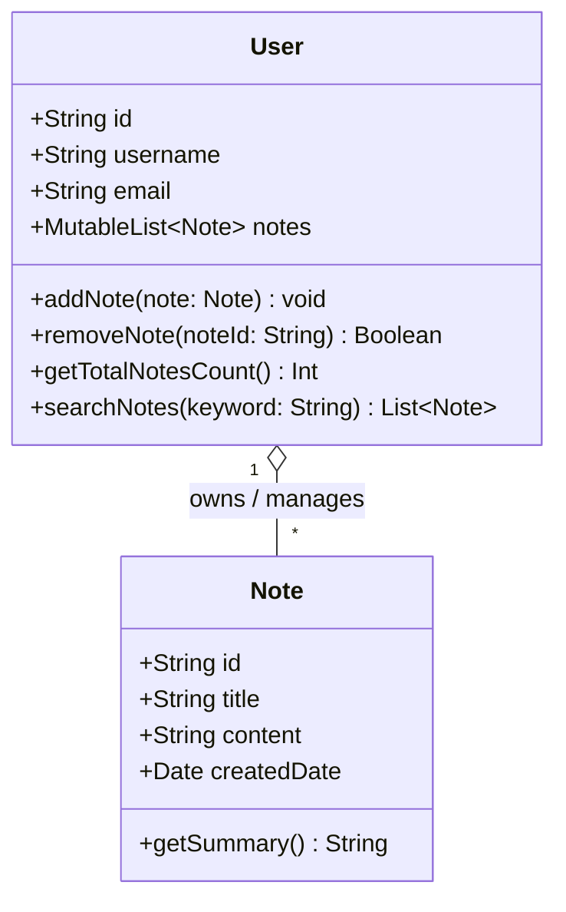

# Note-Taking Application - Class Diagram & Architecture

This document outlines the class diagram and object-oriented design for the Note-Taking Application.

## Class Diagram (UML)

## Class Descriptions

### 1. `Note` Class (`Note.kt`)
Represents an individual note created by a user.
- **Attributes:**
  - `id` (`String`): Unique identifier for the note.
  - `title` (`String`): Title of the note.
  - `content` (`String`): Full body text of the note.
  - `createdDate` (`Date`): Timestamp when the note was created.
- **Methods:**
  - `getSummary(): String`: Returns a shortened preview of the note content (up to 50 characters, truncated with `...` if longer).

### 2. `User` Class (`User.kt`)
Represents the application user who owns and manages a collection of notes.
- **Attributes:**
  - `id` (`String`): Unique identifier for the user.
  - `username` (`String`): Display name of the user.
  - `email` (`String`): User's email address.
  - `notes` (`MutableList<Note>`): Collection of notes belonging to the user.
- **Methods:**
  - `addNote(note: Note)`: Adds a new note to the user's collection.
  - `removeNote(noteId: String): Boolean`: Removes a note by its ID.
  - `getTotalNotesCount(): Int`: Returns the total number of notes owned by the user.
  - `searchNotes(keyword: String): List<Note>`: Filters and returns notes matching the keyword in title or content.
